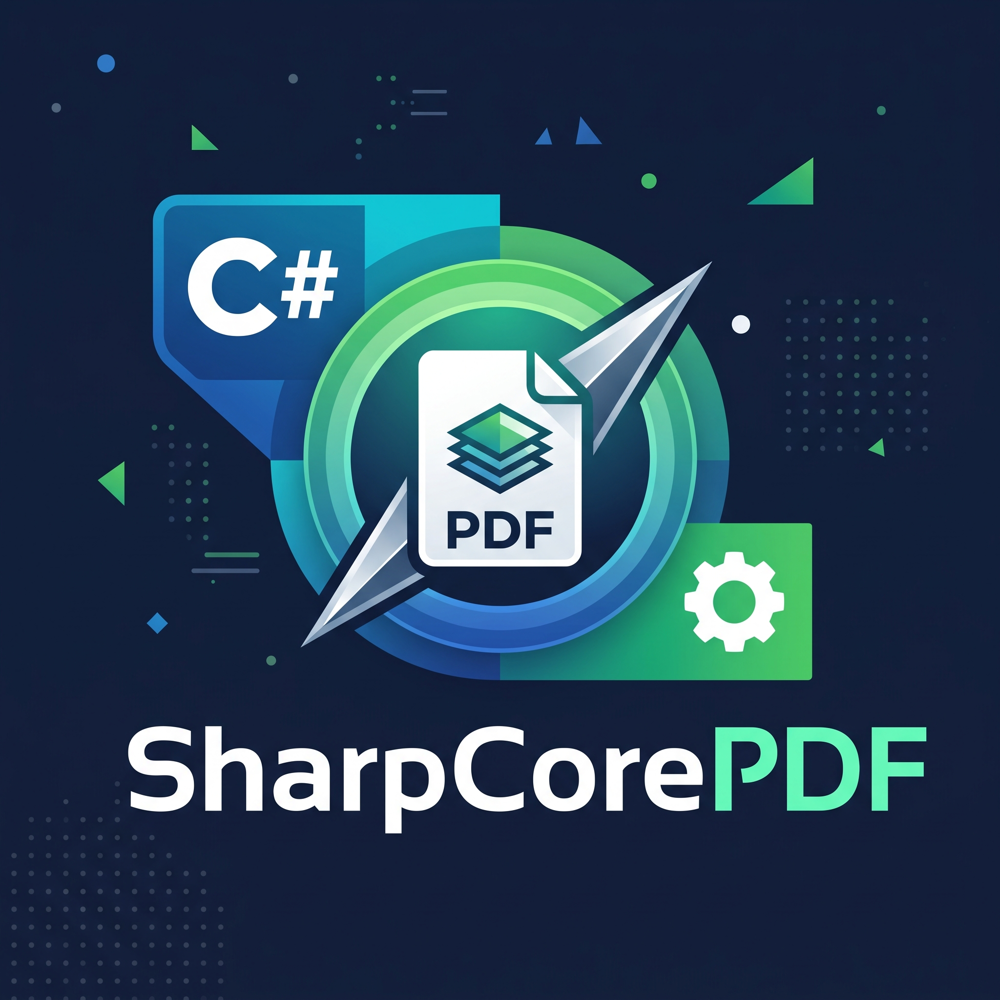

<p align="center">
  
</p>

# SharpCorePDF

A dependency-injection first, domain-driven PDF library for .NET 10 and .NET 11, built around one
capability done properly: **merging PDF documents** — whole documents, selected pages, in any order.

Every PDF byte is read and written by this library. There is no dependency on a third-party PDF
engine, no native binary and no licence to accept: the reader, the writer and the merge engine are
part of the package, and they are covered by tests against real-world documents and validated with
independent implementations (`qpdf` via `pikepdf`, and `pypdf`).

## What it does

```csharp
using SharpCorePDF.Domain.Aggregates;
using SharpCorePDF.Domain.Ports;
using SharpCorePDF.Infrastructure.Extensions;

var plan = MergePlan.Create()
    .AddFile(@"C:\reports\summary.pdf")                // every page
    .AddFile(@"C:\reports\appendix.pdf", pages: "1-3") // one-based, "1,3-5,8-"
    .AddFile(@"C:\reports\annex.pdf", pages: "3,1");   // in this order

await merger.MergeToFileAsync(plan, @"C:\reports\combined.pdf");
```

* **Page selections** in the notation people write: `5`, `2-7`, `3-`, `-4`, comma separated, in the
  order they are given. Page numbers are always one-based.
* **Everything of every source travels with its pages**: content streams, images, fonts, resources,
  annotations, bookmarks and form widgets. Stream bytes are copied verbatim — nothing is re-compressed.
* **One flat page tree** in the result, with the inheritable page attributes (`Resources`, `MediaBox`,
  `CropBox`, `Rotate`) materialised onto each page, which is what makes partial selections and
  reordering possible.
* **Bookmarks of every source** are merged into one tree whose top level items follow the source order.
* **Document level features** — viewer preferences, page layout and mode, the interactive form, named
  destinations, embedded files, page labels, XMP metadata — are carried over from the primary source,
  because they cannot sensibly exist twice in one document.
* **Document information** is taken from the primary source, merged from all sources, or suppressed;
  an explicit override always wins. Fix `ModificationDate` and the output is reproducible byte for byte.
* **Diagnostics instead of surprises**: damaged cross-reference tables are rebuilt by scanning the
  file, unselected pages that something still points at are folded onto a page that exists, and
  anything the merge had to change is reported in `MergeResult.Warnings`.

## Getting it into a project

The dependency injection package wires everything behind its ports:

```csharp
using SharpCorePDF.DependencyInjection;
using SharpCorePDF.Domain.Ports;

services.AddSharpCorePDF();                                      // default engine options
services.AddSharpCorePDF(PdfEngineOptions.Default with { ... });  // explicit options
services.AddSharpCorePDF(configuration);                         // from the "SharpCorePDF" section
services.AddSharpCorePDF(configuration, "My:Pdf:Section");       // from a section of your choosing

var merger = provider.GetRequiredService<IPdfMerger>();
var inspector = provider.GetRequiredService<IPdfInspector>();
```

`IPdfInspector.InspectAsync` describes a document — version, page count and sizes, rotation, metadata,
bookmarks, embedded files, form presence, warnings — and reports an encrypted document instead of
throwing, so a caller can decide what to do before merging anything.

The packages are not on nuget.org yet. Until they are, reference the projects
(`dotnet add reference .\src\SharpCorePDF.DependencyInjection\SharpCorePDF.DependencyInjection.csproj`), or
pack all four into a local feed and install them from there:

```powershell
dotnet pack .\SharpCorePDF.slnx -c Release -o $env:TEMP\SharpCorePDF-feed
dotnet nuget add source $env:TEMP\SharpCorePDF-feed --name SharpCorePDF
dotnet add package SharpCorePDF.DependencyInjection --prerelease
```

## Examples

[`examples/SharpCorePDF.Examples`](examples/SharpCorePDF.Examples) is a console app with eight runnable
examples. Every snippet on this page is code that compiles and executes there:

```powershell
dotnet run --project .\examples\SharpCorePDF.Examples -c Release          # all of them
dotnet run --project .\examples\SharpCorePDF.Examples -- select-pages    # one of them
dotnet run --project .\examples\SharpCorePDF.Examples -- errors options  # several, in this order
```

| Example | Shows |
| --- | --- |
| `merge-files` | Three documents from disk into one file, and what each source contributed. |
| `select-pages` | `3,1`, `2-`, `-2` and `2,2,1`: a selection is an order rather than a set, and it can be built in code too. |
| `merge-streams` | A source that is an upload stream, and one that is already a `byte[]`. |
| `no-container` | The same merge without a container, and the proof that both routes write the same bytes. |
| `inspect-first` | Describing a folder of documents before merging: an encrypted or unusable file is reported, not thrown. |
| `options` | Metadata policy and override, outline and page-label policy, the target version, reproducible output. |
| `warnings` | What inspection reports about a document, versus what a merge reports about its own work. |
| `errors` | Every refusal a caller can meet, with the exception type and the message the library produces. |

The examples generate the documents they merge, so nothing else is needed to run them, and they leave the
results in a folder under the temporary directory for you to open. [`examples/README.md`](examples/README.md)
walks through each one.

## How it is put together

| Project | Contents |
| --- | --- |
| `SharpCorePDF.Domain` | The `MergePlan` aggregate, the `PdfSource` entity, value objects (`PageSelection`, `PageRange`, `PdfMetadata`, `PdfVersion`, `PdfPageSize`, `PageRotation`, the policies), the read models and the ports (`IPdfMerger`, `IPdfInspector`, `IPdfContentSource`). No I/O, no third-party code. |
| `SharpCorePDF.Application` | The use cases: `PdfMergerService` (validate, open, inspect, resolve selections, hand over to the engine, release every stream) and `PdfInspectorService`, plus the extension methods callers use. |
| `SharpCorePDF.Infrastructure` | The engine: the object model, the lexer, the object parser, the filter decoders, cross-reference tables, cross-reference streams, object streams, the page tree walk, the object copier, `PdfMergeEngine`, `PdfDocumentReader`, the writer and the content sources. |
| `SharpCorePDF.DependencyInjection` | `AddSharpCorePDF()` registration. |

The domain and the application layer know nothing about PDF syntax; the engine implements their ports.
That is what keeps the merge rules testable without a single PDF file, and what would let a different
engine be swapped in.

### Why the engine looks the way it does

* A source is read into memory once and its objects are resolved on demand, so a damaged object that no
  page needs never stops a merge.
* Objects are copied in two phases: first every reachable object is *reserved* a target number, then
  the bodies are written. That is what makes the cyclic graphs real files contain — a form field that
  points at its widget which points back at the field — terminate.
* Only objects reachable from the kept pages and features are copied, so the result does not inherit
  the dead weight of its sources.
* Object streams and cross-reference streams are decoded (their contents have to be understood); every
  other stream is copied byte for byte. The result uses a classic cross-reference table, which every
  reader in existence supports.

## Known limits (deliberate, for version 1)

* **Encrypted documents are refused** with `PdfEncryptionException`; no decryption is attempted, so
  `PdfDocumentInfo.RequiresPassword` is always `false` — the engine cannot know whether an empty user
  password would have opened the file.
* **Named destinations are merged from the primary source only.** A bookmark of another source that
  used a named destination keeps its title and loses its destination, and the merge says so in its
  warnings.
* **The result is written as PDF 1.4 – 2.0 with a classic cross-reference table** and no object
  streams; `MergeOutputOptions.TargetVersion` (default PDF 1.7) decides the header.
* A reference to a page that was **not selected** is folded onto the first page that source
  contributed, so a link stays valid instead of dangling.
* A bookmark that is stored inline in the page tree (not as an indirect object) cannot be referenced
  and is skipped, with a warning.

## Building and testing

```powershell
# Everything at once, through the solution: the four packages, the tests,
# the examples, the measurement harness and the web host.
dotnet build .\SharpCorePDF.slnx -c Release
dotnet test  .\SharpCorePDF.slnx                      # 52 tests on net10.0, 52 on net11.0
dotnet run --project .\examples\SharpCorePDF.Examples -c Release

# Or one project at a time:
dotnet build .\src\SharpCorePDF.DependencyInjection\SharpCorePDF.DependencyInjection.csproj

# The test project must build an app host, which the RID-less net10.0 leg of some SDK builds skips:
dotnet test .\tests\SharpCorePDF.Tests\SharpCorePDF.Tests.csproj -p:TargetFramework=net11.0
dotnet test .\tests\SharpCorePDF.Tests\SharpCorePDF.Tests.csproj -p:TargetFramework=net10.0 -r win-x64
```

The tests cover the domain invariants, the serialisation details, the reader against a real-world
document, a document that uses object streams and cross-reference streams, a document with bookmarks,
page labels, annotations and a rotated page, an encrypted document, and the whole merge path through
the container.

### Measuring what a merge costs

```powershell
dotnet run -c Release --project .\tools\SharpCorePDF.Measure
dotnet run -c Release --project .\tools\SharpCorePDF.Measure -- --single large

# GC mode is part of the measurement, and server mode is the deployment envelope:
$env:DOTNET_gcServer = "1"; dotnet run -c Release --project .\tools\SharpCorePDF.Measure
```

The harness reports the bytes a merge allocates, its wall time, the same allocations as a multiple of
the input, throughput, the heap still held after a full collection, and the bytes the merge wrote — that
last column is a fingerprint, because two runs that write the same bytes ran the same merge.
`--single <all|large|one|half>` samples the managed heap during one isolated merge, which is what "peak"
means. The recorded numbers, and what they say about the performance and memory budgets, are in
[`docs/measurements.md`](docs/measurements.md).

### Validating the output with an independent implementation

```powershell
uv run --with pikepdf python .\docs\tools\validate-pdf.py <file.pdf>
uv run --with pikepdf python .\docs\tools\make-fixtures.py .\tests\SharpCorePDF.Tests\Assets
```

`validate-pdf.py` runs `qpdf --check`, decodes every stream in the file, and prints the geometry,
rotation and annotations of every page. It is the check that caught the one bug this library has had so
far: a hexadecimal string written with name escapes, which `qpdf` rejected as damage.

